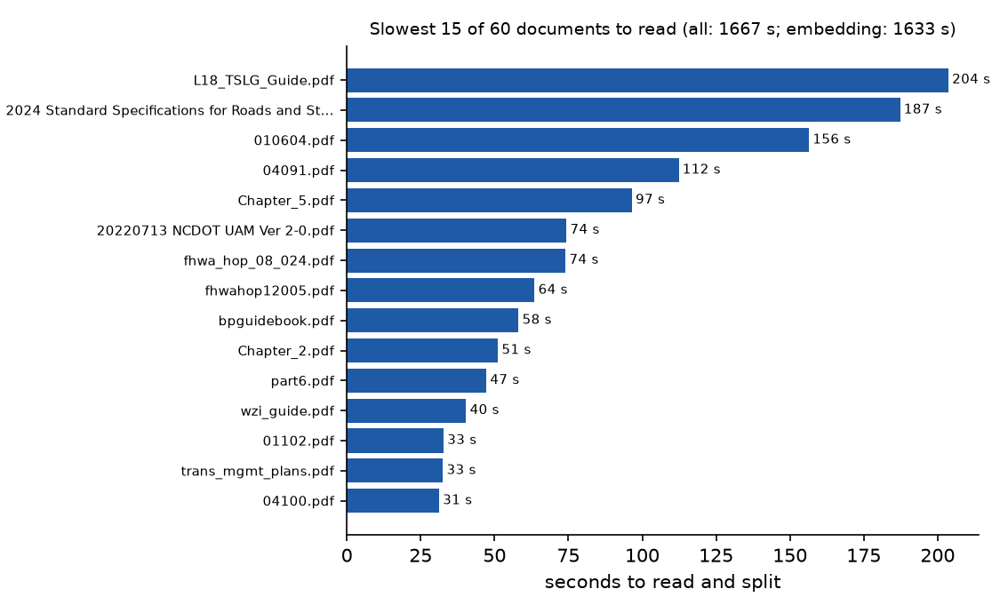
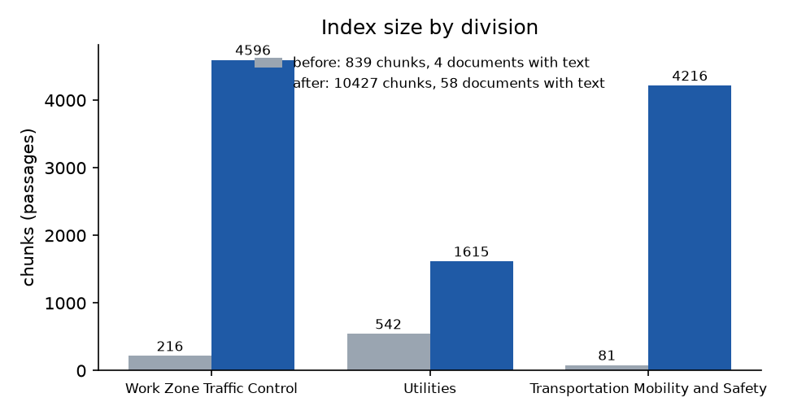
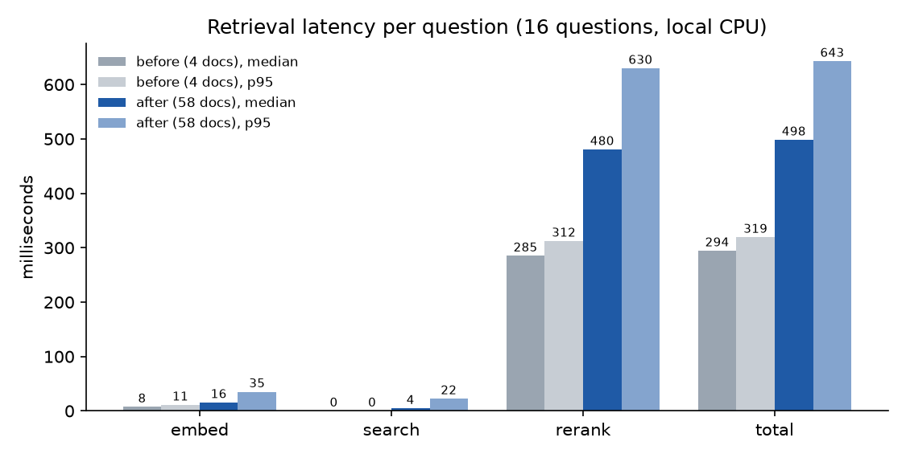
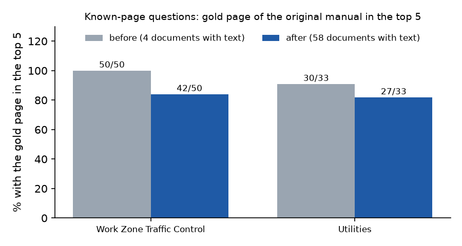

# 50-document stress test (DAR-621)

Dr. Namian asked on Oct 22 what happens when the assistant holds about 50 public
documents instead of four. We loaded 56 more public PDFs into the three real
divisions, the same way production adds documents: PDFs in
`hosted/documents/<division>/`, one row each in `hosted/divrag/divisions.py` and
`docs/source-documents/SOURCES.md`, then `python -m prototype.ingest`. We then
measured build time, index and bundle size, retrieval and answer time, and what broke.

Measured on 2026-10-27 on the development machine (16 logical CPUs, Windows 11,
the repo's `.venv`). Vercel's CPU is slower, so read the times as relative, not
production numbers. Rerun everything with `prototype/stress_test.py` (see
[How to rerun](#how-to-rerun)). The raw results are in `docs/stress-test/*.json`.

## Summary

| | Before (DAR-622) | After (this test) |
|---|---|---|
| Documents loaded | 4 | 60 (58 kept in the lists, see below) |
| Documents with text in the index | 4 | 58 (2 scanned PDFs produced nothing) |
| PDF pages | 534 | 5,924 |
| Chunks (passages) | 839 | 10,427 |
| Full index build | 154 s (86 s read + 68 s embed) | 3,301 s, about 55 min (1,667 s read + 1,633 s embed) |
| `hosted/index/` size | 2.1 MB | 23.8 MB (chunks.json 15.8 MB, vectors.npy 8.0 MB) |
| Index load at startup / memory | 9 ms / 4 MB | 98 ms / 42 MB |
| Retrieval per question, median (p95) | 294 ms (319) | 498 ms (643), see the caveat below |
| Full answer, median of the timed questions | 2.2 s (6 questions) | 2.4 s (7 questions) |
| Wrong-division hits | 0 of 2,600 | 0 of 2,624 |
| Known-page questions with the gold page in the top 5 | 80 / 83 | 69 / 83 |
| Deploy bundle (estimate) | about 280 to 340 MB | about 300 to 360 MB, under Vercel's 500 MB |

Main findings:

- **The bundle and runtime scale fine.** At 10,000 chunks the index is 24 MB and
  loads in a tenth of a second.
- **Division isolation holds.** Not one of 2,624 retrieved chunks came from another division.
- **Answers still cite the right document and page.** All 7 timed questions did.
- **What gets worse is ranking.** The original manuals now share the 20 vector
  candidates with 18 to 20 other documents per division, so 11 known-page
  questions lose their gold page from the top 5.
- **Two scanned PDFs went in silently with no text at all.** They were measured, then taken out of the lists (`divisions.py`, `SOURCES.md`), so the app lists 58 documents, each with passages.

## What was loaded

56 new PDFs (209.6 MB). Each was downloaded over https from a public government
host and checked for a `%PDF-` header. Each is filed under the division whose topic it covers:

| Division | NCDOT | FHWA | 23 CFR / Federal Register (govinfo) | New documents | Pages | MB |
|---|---|---|---|---|---|---|
| Work Zone Traffic Control (`wztc`) | 11 | 7 | 2 | 20 | 2,338 | 91.5 |
| Utilities (`utilities`) | 8 | 8 | 2 | 18 | 774 | 51.7 |
| Transportation Mobility and Safety (`tmsd`) | 9 | 7 | 2 | 18 | 2,278 | 66.4 |
| **Total** | **28** | **22** | **6** | **56** | **5,390** | **209.6** |

The full list, with each document's source URL, is in `docs/source-documents/SOURCES.md`.
Highlights:

- **NCDOT:**
  - the 2024 Standard Specifications (857 pages);
  - the 2024 Roadway Standard Drawings, Division 11 (work zone drawings);
  - Maintenance/Utility Traffic Control Guidelines chapters 2 and 5;
  - the Traffic Services Legal Guide (706 pages of statutes);
  - the DMV-349 crash report manual;
  - the Policy on Street and Driveway Access;
  - the Signal System Timing Philosophy Manual;
  - Roadway Design Manual chapters;
  - utility encroachment guides, forms and memos.
- **FHWA:**
  - MUTCD 11th edition Part 6, Part 3 and Chapter 2C;
  - work zone guides: best practices, TMPs, impacts assessment, road user costs, ITS;
  - the utility relocation Program Guide and the Highway/Utility Guide;
  - SUE and broadband briefs;
  - the Traffic Signal Timing Manual;
  - pedestrian safety guides;
  - the Signalized Intersections guide.
- **Regulations:** 23 CFR parts 630, 645, 710, 924 and 655, and the 2004 work zone final rule (69 FR 54562).
- **Deliberately hard ones:**
  - two scanned PDFs (the NCDOT Work Zone Safety and Mobility Policy and the Revised Rumble Strip Guidelines);
  - drawing-heavy manuals (the MUTCG chapters and the Division 11 standard drawings);
  - table-heavy ones (Road User Costs, the crosswalk study, MUTCD Chapter 2C, the 23 CFR 655 color tables).

**Not loaded:**

- **Office of Federal Lands Highway.** Every FLH document is served from
  highways.dot.gov: the Project Development and Design Manual chapters, FP-24 and the
  standard drawings. That host answered scripted downloads with 403 Access Denied
  on Oct 27. The fetch script could not rebuild the index from them, so none were
  added.
- **Other blocked or broken sources.**
  - Several FHWA safety PDFs under `highways.dot.gov/sites/fhwa.dot.gov/files/`
    and rosap.ntl.bts.gov were blocked the same way: speed management, Proven
    Safety Countermeasures, and the HSIP manual.
  - Two ops.fhwa.dot.gov links returned HTML instead of a PDF.
- **No file was over the 60 MB cap.** The largest is the Highway/Utility Guide at 32.8 MB.

## Build time



The full build went from 2.6 minutes to 55 minutes. About half the time is reading
and splitting the PDFs (pymupdf4llm's layout analysis) and half is embedding 10,427
chunks.

- **Reading scales with pages, plus extra time for drawings.** Most documents read at
  0.15 to 0.3 s per page. Drawing-heavy PDFs are slower: MUTCG Chapter 2 took 1.1 s
  per page, and the Highway/Utility Guide 0.5 s per page.
- **The five slowest documents are 45% of the read time:** the Traffic Services
  Legal Guide (204 s), the Standard Specifications (187 s), the Highway/Utility Guide
  (156 s), Signalized Intersections (112 s) and MUTCG Chapter 5 (97 s).
- **Embedding is linear in chunks,** about 6 chunks per second on this machine.

`prototype/ingest.py` now prints each document's read time, its pages with text,
and a warning for documents that lost pages. `--timings FILE` writes these numbers
as JSON. The chunking itself is unchanged: 512 tokens, with the same chunks as
before for the original four documents.

## Index size and the Vercel bundle



- **The index grew from 2.1 MB to 23.8 MB,** about 2.3 KB per chunk (float16
  vectors plus the text in JSON).
- **The index is the only part of the bundle that grows.** The PDFs are never
  deployed: `hosted/documents/` is in both `.vercelignore` files and in `.gitignore`.
  The rest stays the same: dependencies about 185 MB, models about 90 MB, the page.
  The bundle goes from about 280 to 340 MB (README and CLAUDE.md estimates) to about
  300 to 360 MB, under the 500 MB Python limit.
- **Headroom.** At 2.3 KB per chunk, the remaining ~140 MB would hold about 60,000
  more chunks, roughly 300 more documents of this mix. Memory (42 MB per 10,000
  chunks) and startup load (0.1 s per 10,000 chunks locally) would still be small at that size.
- **Skew.** The two longest documents, the Standard Specifications and the Traffic
  Services Legal Guide, are 3,623 of the 10,427 chunks. The Legal Guide alone is 38%
  of TMSD's passages.

## Retrieval and answer time



The 16 fixed questions in `prototype/stress_test.py` (`QUESTIONS`) cover the old
example questions and some eval questions across all three divisions. Each ran 5
times after a warm-up; the table uses the median run per question.

| Step | Before, median / p95 | After, median / p95 |
|---|---|---|
| embed | 8 / 11 ms | 16 / 35 ms |
| vector search (within the division) | 0 / 0 ms | 4 / 22 ms |
| rerank (20 candidates) | 285 / 312 ms | 480 / 630 ms |
| total | 294 / 319 ms | 498 / 643 ms |

**Caveat: much of the jump is machine noise.** The two runs that matter for scaling are search and rerank:

- **Search is the only step that scales with the index.** It is a numpy dot product
  over the division's rows: 4,596 for Work Zone, up from 216. It grew from under
  1 ms to 4 ms (22 ms p95).
- **Rerank should not grow with the index.** It always reads 20 candidates, and
  their length did not change: on average the reranker reads 373 tokens per
  candidate before and 361 after, with 9% and 10% hitting the 512-token cap.
- **A back-to-back rerun after the 55-minute build gave much closer numbers:**
  452 ms median for the old index and 557 ms for the new one.
- **Embedding the question does not depend on the index at all.**

Most of the remaining difference is CPU noise on this machine. Expect retrieval to
stay within a few hundred ms of today's on Vercel.

**Full answers** were timed through a running local server (`POST /api/ask`, the
first free model `nvidia/nemotron-3-ultra-550b-a55b:free`, no retries):

| Question (target) | Before: retrieval / LLM / total | After: retrieval / LLM / total | Cites expected document and page (after) |
|---|---|---|---|
| NC-PCB barrier dimensions (wztc) | 216 ms / 1.7 s / 1.9 s | 454 ms / 1.3 s / 1.8 s | TMP Design Manual p. 32-34 |
| Anchoring PCB on a bridge deck (wztc) | 261 ms / 1.0 s / 1.3 s | 524 ms / 3.1 s / 3.6 s | TMP Design Manual p. 46 |
| Who pays for a detour (utilities) | 291 ms / 1.3 s / 1.6 s | 800 ms / 5.3 s / 6.1 s | UAM p. 127 |
| Bore-and-jack cover (utilities) | 307 ms / 2.1 s / 2.4 s | 646 ms / 1.0 s / 1.6 s | UAM p. 100-101 |
| TODS panels per approach (tmsd) | 290 ms / 2.8 s / 3.1 s | 529 ms / 1.8 s / 2.3 s | TODS Manual p. 7, 25-27 |
| Fatal crash investigation deadline (tmsd) | 266 ms / 13.1 s / 13.4 s | 772 ms / 6.1 s / 6.8 s | Fatal Investigation Guidelines p. 5 |
| TODS fees (tmsd, after only) | | 575 ms / 1.8 s / 2.4 s | TODS Manual p. 9, 18, 27 |

- **The free model's response time dominates** (1 to 13 s, varying from call to
  call). Retrieval is under a second either way.
- **All answers cited the expected document and page.**
- **A new document answered too.** "How wide must the lines of a marked crosswalk
  be?" (TMSD) was answered from MUTCD Part 3, pages 54 and 57 (6 to 24 inches),
  in 5.4 s.

## Division isolation

Every check found 0 wrong-division hits. For each of the 16 timing questions and
the 83 eval questions, the test checked three sets, each against the asked division:

- the 20 vector candidates;
- the reranked top 5;
- the following chunks the app adds for the top 2.

Before: 0 of 2,600 hits from another division. After: 0 of 2,624. The division
filter is applied inside `IndexFile.search`, so this is expected. The test shows it
still holds at 10,000 chunks.

## Quality: do the old questions still find their page?



`eval/retrieval_pages.json` and the table questions are 83 questions with a known
answer page in the TMP Design Manual (50) or the UAM (33). A question passes when one
of the app's top 5 reranked hits is the gold page **of that manual**. Without that
restriction, page 126 of any new document would count as the UAM's page 126.

| Division | Before | After | Newly missed |
|---|---|---|---|
| Work Zone | 50/50 (MRR 0.83) | 42/50 (MRR 0.67) | A1, A6, T1, T7, T8, T11, T17, T25 |
| Utilities | 30/33 (MRR 0.78) | 27/33 (MRR 0.70) | B1, U2, U17 (U7, U14, U19 were already missed) |

This is dilution, not a collapse: 83% of the questions still put the gold page in
the top 5, and every timed answer still cited the right page. The 11 newly missed
cases fall into three groups:

- **Another new document answers the same question equally well (about 4).**
  A1 (intermediate-term stationary work) and T1 (short duration work) are definitions
  MUTCD Part 6 states in the same words. For T17 (pedestrian crossing sign color),
  all five hits are MUTCD Part 6, with the same answer. For U17 (Buy America), the FHWA
  Program Guide covers the same federal rule.
- **An NCDOT-specific rule loses to a general federal document.**
  - T7: NCDOT's user-cost basis, "135% of 1981 dollars", loses to FHWA's Road
    User Costs guide. An answer could describe FHWA's method instead of NCDOT's.
  - T11: payment of private engineering firms loses to the Standard
    Specifications' payment clauses.
  - U2: the railroad permit loses to the FHWA Program Guide.
- **The gold chunk falls out of the 20 vector candidates.** B1 (UAM lane-closure
  distances, page 126) was rank 1 before. Now it is the 22nd vector hit, so the
  reranker never sees it. A6 (36th), T25 (24th) and the cases above fail the same
  way, because more documents now compete for the same 20 candidate slots.
  - **Experiment:** with 40 candidates instead of 20, 75 of 83 pass (Work Zone
    44/50, Utilities 31/33). That recovers 6 of the 11 at roughly twice the rerank
    time, since the reranker reads one passage per call.

## What broke

| Problem | Where | Effect |
|---|---|---|
| Scanned PDF, no text layer | `WZSafety_and_Mobility.pdf` (wztc, 5 pages), `Revised Rumble Strip Guidelines.pdf` (tmsd, 9 pages) | 0 chunks. The build used to finish without a word; now it prints a warning. Listed, they showed 0 passages: they could be ticked but never cited. Both were removed from the lists after the test. |
| Partly image-only PDFs | Highway/Utility Guide `010604.pdf` (316 pages, text on 226; pages 228 to 316 lost), MUTCG `Chapter_2.pdf` (26 of 48), `Chapter_5.pdf` (79 of 93) | The drawings and scanned appendices are not searchable. The loader drops empty pages silently. |
| Drawings read as word soup | Roadway Standard Drawings `Division 11 Combined.pdf` (123 chunks) | The rotated title blocks come out scrambled (page 10 starts "SOATTEF NOCOANARTHRLI GHCARLEIN"), and the drawing labels come out as strings of words with no structure ("TMA BUFFER MERGE TAPER 5 DRUMS @ SPACE SPACE"). These chunks can still match a question but rarely support a citation. |
| Tables of contents read as tables | Crosswalk study `04100.pdf` (92 of 259 chunks are mostly dot leaders and numbers), WZ Safety and Mobility Guidelines page 2 | Dotted TOC lines become Markdown table rows full of `....`, so the chunks are noise in the vector search. |
| Wide numeric tables split mid-word | 23 CFR 655 page 5 (headers "Chro\|maticity Co\|ordinates") | The table survives but its header is broken. Values are still there for the reranker. |
| A part's first page starts with the previous part | govinfo part PDFs, e.g. 23 CFR 645 page 1 opens with the end of part 637 (laboratory accreditation) | That text is filed and cited as Part 645. |
| Private-use glyphs | 43 chunks in 5 documents (UAM, Standard Specifications, Signal Timing Philosophy, two FHWA reports) | Minor: bullets and symbols mapped to unprintable characters. |
| Ranking dilution | Work Zone and Utilities known-page questions | 80/83 → 69/83, see above. |
| Build time | Full rebuild | 2.6 min → 55 min. Every document change rebuilds everything. |

Nothing broke in the app itself:

- `/api/divisions` listed all 60 documents with passage counts (58 after the scanned two were removed).
- The server started and answered normally.
- The tests pass.
- The time budget is not at risk: retrieval stays under a second, against 55 s.

## Recommendations

1. **Don't ship scanned documents silently.** Ingest now warns when a document
   yields no text or loses pages, and `tests/test_hosted_api.py` fails when a listed
   document has no passages in the committed index. OCR such PDFs before adding them,
   or leave them out of `divisions.py`, as we did with the two scanned ones here.
2. **Give each division's primary manual priority.** Two options keep the general
   documents from outranking NCDOT's own rules (T7, T11, B1):
   - mark the primary documents in `divisions.py` and give them a small score boost;
   - or tick only the primary manual on the page by default, and let visitors add the rest.
3. **Raise the rerank candidates for large divisions** from 20 to about 40. It
   recovered 6 of the 11 lost questions, but costs about twice the rerank time.
   Measure that on Vercel before changing `RERANK_CANDIDATES`.
4. **Clean up at read time:**
   - drop table-of-contents pages and pymupdf4llm's "picture text" blocks;
   - trim govinfo CFR parts to start at their part heading.
5. **Make the build incremental.** Cache each document's chunks and vectors by file
   hash, so adding one PDF takes minutes, not a 55-minute full rebuild.
6. **Add eval questions for the new documents,** so their quality is measured
   rather than inferred.

## How to rerun

```bash
# documents (skips PDFs already present) and the index, with per-document timings
.venv\Scripts\python hosted/scripts/fetch_documents.py
.venv\Scripts\python -m prototype.ingest --timings docs/stress-test/after-build.json

# retrieval latency, wrong-division check, hit@5 and per-document numbers; with
# --answers it also times full answers against a running server (uses the LLM,
# one free-model call per question)
.venv\Scripts\python -m uvicorn index:app --app-dir hosted --env-file .env --port 8104
.venv\Scripts\python -m prototype.stress_test measure --label after --out docs/stress-test/after.json --answers http://127.0.0.1:8104 --answer-limit 7

# charts (docs/charts/stress-*.png)
.venv\Scripts\python -m prototype.stress_test chart docs/stress-test/before.json docs/stress-test/after.json --build docs/stress-test/after-build.json
```

The "before" numbers came from the index committed by DAR-622 (839 chunks), measured
the same way before the 56 documents were added.
