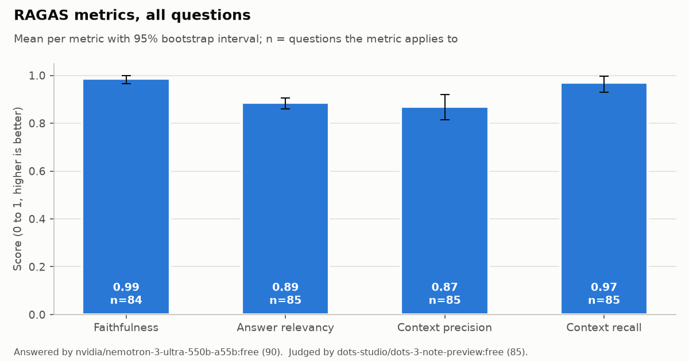
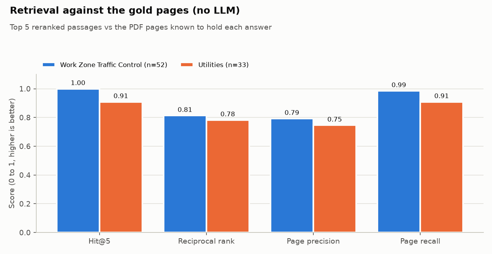
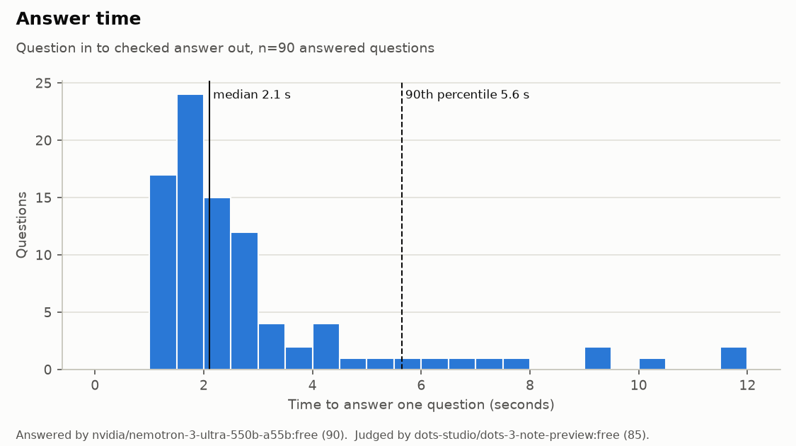
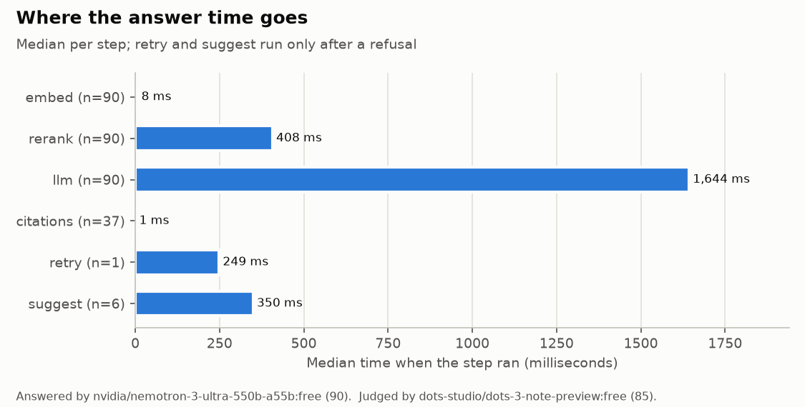

# RAG evaluation results

Run on 27 October 2026 against the committed index (758 chunks; Work Zone Traffic Control and Utilities). [METRICS.md](METRICS.md) defines each metric, its sources and how it is measured, and `results/scores.json` has every question's scores. The run is reproducible from `results/cache.jsonl` with `python -m evaluation.run_ragas --stage report`.

## What was measured

- **Questions:** 90 (`testset.json`). 85 are answered by the manuals (52 Work Zone, 33 Utilities): 70 known-page questions, 13 table questions and 2 from the TMP test set. The other 5 (Q9, N1-N4) are not answered by the asked division's documents.
- **Answers:** the hosted app's own pipeline and settings: retrieval in the asked division only, rerank, top 5, the same prompt, citation check, retry and refusal as `/api/ask`. All 90 answers came from `nvidia/nemotron-3-ultra-550b-a55b:free` on OpenRouter. Its fallbacks (Nemotron Super, Gemma 4 31B) were never needed.
- **Judge:** one JSON call per answer on a free OpenRouter model from a different family. The configured judge was `google/gemma-4-31b-it:free`, but it was rate-limited upstream throughout the run, so OpenRouter's fallback `dots-studio/dots-3-note-preview:free` scored all 85 verdicts. No local or paid model was used.
- **Coverage:** 90/90 questions answered or refused, 85/85 judged. A refused question the documents don't answer needs no verdict.

## Headline numbers

Mean with 95% bootstrap interval; n = questions the metric applies to.

| Metric | All | Work Zone | Utilities |
|---|---|---|---|
| Faithfulness | **0.99** [0.96-1.00], n=84 | 0.98 [0.94-1.00], n=52 | 1.00 [1.00-1.00], n=32 |
| Answer relevancy | **0.89** [0.86-0.91], n=85 | 0.91 [0.89-0.92], n=52 | 0.85 [0.79-0.89], n=33 |
| Context precision | **0.87** [0.81-0.92], n=85 | 0.92 [0.86-0.97], n=52 | 0.80 [0.69-0.90], n=33 |
| Context recall | **0.97** [0.93-1.00], n=85 | 0.99 [0.98-1.00], n=52 | 0.93 [0.84-1.00], n=33 |
| Gold page in top 5 (hit@5) | **0.96** [0.92-1.00], n=85 | 1.00, n=52 | 0.91 [0.79-1.00], n=33 |
| Reciprocal rank of the gold page | 0.80 [0.73-0.87] | 0.81 | 0.78 |
| Page precision / page recall | 0.77 / 0.96 | 0.79 / 0.99 | 0.75 / 0.91 |
| Table questions graded correct | 0.92 (12/13) | 0.92 (12/13) | - |
| Correct refusal (not in the documents) | **1.00** (5/5) | 4/4 | 1/1 |

Outcomes: 78 answered with citations, 6 answered without a valid citation (shown in the app as "No source cited"), and 6 refused. Five of the refusals are correct; one (U14) is a question the manual does answer.

**Answer time** (question in to checked answer out): median 2.1 s, 90th percentile 5.6 s, maximum 11.7 s (n=90). The LLM call is most of it (median 1.6 s), then reranking (0.4 s); embedding and the citation check take milliseconds.

Per-division charts for each RAGAS metric: [faithfulness](charts/faithfulness.png), [answer relevancy](charts/answer_relevancy.png), [context precision](charts/context_precision.png), [context recall](charts/context_recall.png).

## What went wrong

- **One unsupported answer (Q6):** "At 70 mph, what's the smallest radius the table gives a correction factor for?" The app answered "380 ft" with no citation. The table's 70 mph column stops at 1640 ft. This is the one table question graded wrong and the only answer the judge found unfaithful.
- **Six uncited answers, all Work Zone table lookups** (Q1, Q2, Q4, Q6, H3, TMP9): the model gave a bare value ("23 ft") without a `[n]` marker. Five of the six are correct and supported. The app keeps them and flags them rather than refusing.
- **One wrong refusal (U14):** the performance bond rule (UAM p. 40) did not reach the top 5. The retry with the next model did not produce an answer either.
- **Three Utilities page misses** (U7, U14, U19): for U7 the app cited the form itself in Appendix C (p. 198) instead of the gold page's list of forms, which still answers the question. U19 (the manual's intended audience) was answered from the introduction (p. 11) instead of the gold page (p. 144), so the answer is vaguer than the reference.
- **Partial context recall** on a few multi-part questions (X1, Q4, TMP9), where one statement of the reference was not in the passages.

## Caveats

- **The judge is a free preview model.** dots-3-note-preview is not one of the judges the LLM-as-a-judge literature validated. Faithfulness and recall near 1.0 should be read as "no problems found by this judge", not as human-checked. A rerun with a stronger judge needs only `--judge-base-url https://api.openai.com/v1 --judge-models gpt-4o-mini` and `JUDGE_API_KEY`. Cached answers are reused, so only the 85 judge calls are made again.
- **Answer relevancy uses the app's own small embedding model** (bge-small) rather than RAGAS's default OpenAI embeddings, so its absolute level is not comparable with published RAGAS numbers. It is comparable between runs of this script.
- **Times were measured from a local machine calling OpenRouter**, with retrieval on the local CPU, not on Vercel. Free-model latency varies with load. During the answer stage five calls hit upstream 504 timeouts; they were left uncached and asked again on the resume pass, so only the successful attempts are in the time distribution.
- **Reference answers** come from the hand-checked "Expected" answers in `hosted/RESULTS-local.md`, the table notes, the TMP test set, or, for the T and U questions, the sentence of the manual holding the key phrase. Some of the extracted sentences carry PDF layout noise (U7's starts mid-sentence). Context recall is only as good as these references.
- **90 questions on two manuals.** The intervals are wide for Utilities (n=33). The test set is built from questions written while the app was being tuned, so it is not a held-out sample.
